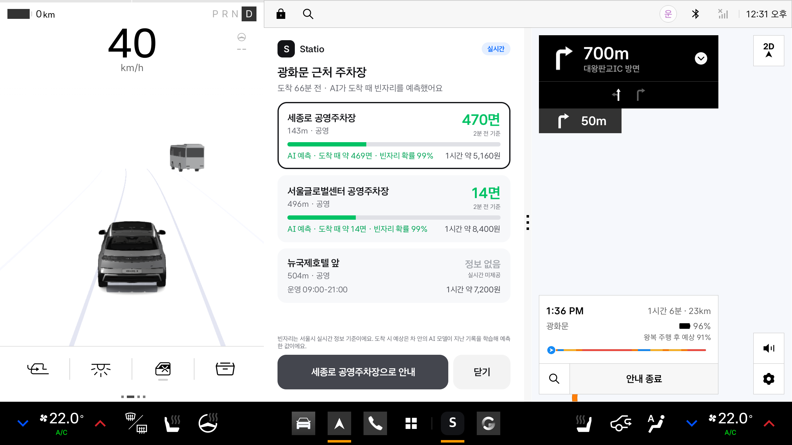
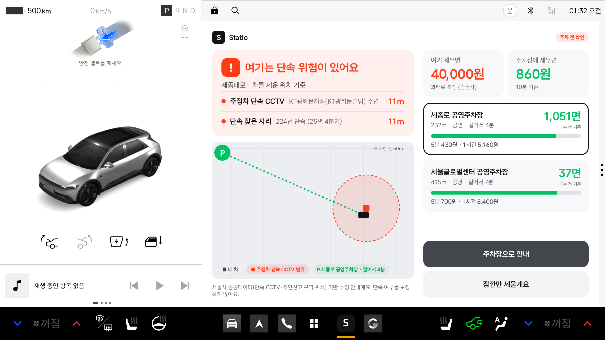
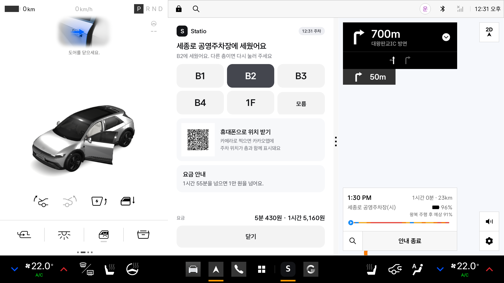
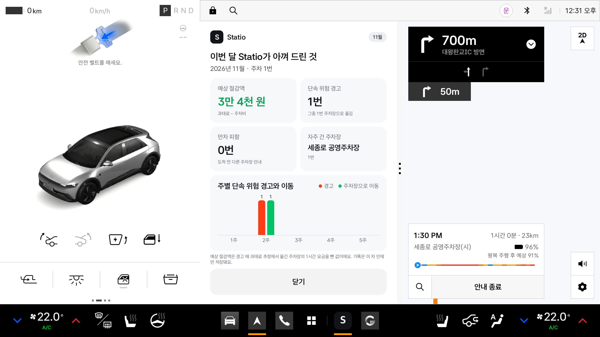

# Statio (스타티오)

> 라틴어 *statio*(멈춰 선 곳, 정류소)에서 따온 이름이에요. station의 어원이에요.

**차를 세우는 순간 "여기 세워도 돼요?"에 답하는 Pleos Connect 주차 비서 앱이에요.**

- **도착 전:** 내비에 목적지를 정하면 근처 주차장의 실시간 빈자리와, **차 안의 AI가 예측한 도착 때 빈자리·빈자리 확률**을 비교해 보여 주고, 한 번 눌러 그 주차장으로 안내해요.
- **세우는 순간:** 기어가 P로 바뀌면 그 자리의 단속 CCTV·단속 잦은 자리(지난 분기 실제 단속 기록)·소화전·횡단보도·버스정류소·교차로 모퉁이·어린이보호구역을 확인해 과태료 위험을 경고하고, 빈자리 있는 대안 주차장을 보여 줘요.
- **내릴 때:** 운전석 문이 열리면 주차 위치와 층을 기록하고, QR 하나로 휴대폰 지도에 위치를 넘겨요. 다음 요금 구간("1시간 55분을 넘으면 1만 원")도 알려 줘요.
- **한 달 동안:** 경고를 받고 주차장으로 옮긴 기록을 쌓아 **이번 달 예상 절감액**(과태료 − 주차비), 경고·이동 횟수, 만차를 피한 횟수를 월간 리포트로 보여 줘요. 기록은 차 안에만 남아요.

운영 서버 없이 **APK 하나로** 동작해요. 판단에 쓰는 공공데이터는 앱에 들어 있고, 실시간 빈자리만 서울시 API에서 직접 받아요.

## 숫자로 본 Statio
| | 내용 |
|---|---|
| **실제 단속 기록 검증** | 2025년 서울 불법 주정차 단속 기록 약 105만 건 중 **82\~83%가 Statio 경고 범위 안**이었어요(단속 잦은 자리는 지난 분기 기록으로 만들어 맞댐). 같은 기록을 100\~300m 옮긴 임의 지점은 39\~40%예요([docs/단속기록_대조.md](docs/단속기록_대조.md)) |
| **단속 잦은 자리** | 지난 분기 단속 기록으로 만든 자리가 **다음 분기 실제 단속의 66\~67%를 미리 짚었어요**(임의 지점 10\~11%). 화면에는 '224번 단속 (25년 4분기)'처럼 횟수로, 단속이 몰리는 자리는 '55번 · 평일 18\~21시'처럼 시간대까지 보여 줘요. 이렇게 정한 시간대에 다음 분기 그 자리 단속의 49\~51%가 들었어요(서울 전체 최다 시간대 24\~27%) |
| **차 안의 AI** | 5분마다 모은 서울 시영주차장 기록으로 학습한 모델이 도착 때 빈자리와 만차 위험을 차 안에서 예측해요. 앱에 넣은 모델을 그대로 두고 그 뒤 쌓인 하루치로 채점하니, **도착 때 만차의 84%를 미리 잡았고**(경고의 76%가 실제 만차) 빈자리 오차는 지금 값 그대로 볼 때보다 50% 작았어요(예비 결과, [ml/reports/shipped.md](ml/reports/shipped.md)) |
| **APK 하나** | 위험 지점 18만여 곳과 서울 주차장 840곳이 앱에 들어 있어요. 차 위치는 서버로 보내지 않아요 |
| **같은 답 보장** | 파이썬 기준 구현과 Kotlin 앱이 정답 사례 56곳(위험 판단)과 290개 상황(빈자리 예측)에서 같은 답을 내는지 테스트로 확인해요 |

## APK 설치와 실행
**APK:** [apk/Statio_release.apk](apk/Statio_release.apk) (release 서명, 버전 0.4.0, 19.6MB)

**테스트 환경**
| 항목 | 내용 |
|---|---|
| 에뮬레이터 | Pleos Connect 에뮬레이터 v2.1.0 (Android 14 기반, arm64-v8a, 2560×1440) |
| 화면 | 내비 옆 세로 분할 창(폭 약 840dp)과 가로 전체 창 모두 확인 |
| 차량 신호 | 에뮬레이터 Virtual Console로 기어·속도·운전석 문을 바꿔요 |

**설치**
```bash
adb install "apk/Statio_release.apk"
```
- 필요한 권한(기어·도어·내비·인터넷)은 설치하면서 모두 허용돼요. 따로 켤 설정은 없어요.
- 서울시 실시간 빈자리 API 키가 APK에 들어 있어서 인터넷만 연결돼 있으면 돼요. 연결이 없으면 실시간 빈자리 없이 나머지 기능이 동작해요.
- 디버그 빌드를 설치한 적이 있으면 서명이 달라 설치가 거절돼요. `adb uninstall com.statio.app` 뒤 다시 설치해 주세요.

**실행 순서**

에뮬레이터 내비 위치는 경기도 성남시에 고정돼 있어요. 그래서 앱에 넣어 둔 서울 시연 위치를 골라 써요.
시연 영상과 같은 순서예요.
1. Statio를 열고 대기 화면의 **시연 위치**에서 '광화문 세종대로'를 골라요. 주행 중에는 고를 수 없어요.
2. **도착 전 주차장 비교**는 내비에 목적지가 정해지면 떠요. 카드마다 'AI 예측 · 도착 때 약 N면 · 빈자리 확률 N%'가 나와요. 에뮬레이터에서는 이 명령으로 목적지를 정할 수 있어요.
   ```bash
   adb shell am start -n com.statio.app/.MainActivity --es cmd route --es lat 37.5724 --es lon 126.9769 --es name 광화문
   ```
3. Virtual Console에서 기어를 D → P로 바꾸면 **P단 단속 경고**가 떠요. 단속 CCTV 11m와 단속 잦은 자리(224번 단속, 25년 4분기), 과태료 4만 원 추정, 세종로 공영주차장 안내가 나와요.
4. '세종로 공영주차장으로 안내'를 누르고 다시 D → P로 바꾸면, 그 주차장에 도착한 것으로 봐요. 이어서 **운전석 문**을 열면 위치 기록·층 선택·휴대폰 QR 화면이 나와요.
5. '닫기'를 누르면 대기 화면의 **이번 달 리포트** 카드에 방금 기록이 쌓여 있어요. 누르면 예상 절감액(단속 CCTV 과태료 4만 원 − 세종로 공영주차장 1시간 5,160원 → 3만 4천 원)과 주별 그래프가 나와요.

네 장면을 자동으로 재생하려면 `adb forward tcp:8088 tcp:8088` 뒤 `python3 tools/demo.py --split`을 실행해요(약 65초). 시작할 때 리포트 기록을 비워서, 리포트에는 그 시연에서 쌓인 기록만 나와요. 시연 위치별 결과와 adb 명령은 [android/README.md](android/README.md)에 있어요.

## 화면 (Pleos Connect 에뮬레이터)
| 도착 전 비교 (내비 옆 분할 창) | P단 단속 경고 | 위치 기록·층 선택 | 월간 리포트 |
|---|---|---|---|
|  |  |  |  |

나머지 화면은 [android/screenshots/](android/screenshots/)에 있어요.

## Pleos SDK 사용
| SDK | 쓰는 곳 |
|---|---|
| Vehicle SDK | 기어(`Gear.registerGearSelection`)로 P단 감지, 운전석 도어(`registerDoorPosition`)로 하차 감지 |
| NaviHelper | 목적지·남은 시간(`getDestinationInfo`, `onDrivingInfo`), 현재 위치, 주차장으로 경로 변경(`requestRoute`), 주정차 금지 구간(`onCautionPointInfo`, 보조) |
| AAOS 표준 | 기어·속도 비교 확인 (검증 화면) |

에뮬레이터에서 확인한 내용(권한, 이벤트, Virtual Console 조작 방법)은 [docs/VehicleSDK_명세.md](docs/VehicleSDK_명세.md)에 정리했어요.

## 저장소 구조
| 폴더 | 내용 |
|---|---|
| [apk/](apk/) | 제출용 release APK |
| [android/](android/) | 차량용 앱 (Kotlin). 빌드·시연 방법은 [android/README.md](android/README.md) |
| [datapipe/](datapipe/) | 서울 공공데이터를 받아 위험 지점 DB와 앱 내장 DB를 만들어요 |
| [collector/](collector/) | 서울시 실시간 주차 대수를 5분마다 모아 '도착 시 예상 빈자리' 패턴을 만들어요 |
| [ml/](ml/) | 모은 기록으로 '도착 시 빈자리' 예측 모델을 학습하고 단순 예측과 비교한 리포트를 만들어요(온디바이스 AI 준비) |
| [server/](server/) | 판단 로직의 파이썬 기준 구현이에요. 앱(Kotlin)이 같은 답을 내는지 대조하는 데 써요 |
| [tools/](tools/) | 에뮬레이터 Virtual Console 조작(`vconsole.py`), 시연 영상 자동 재생·녹화(`demo.py`), 맨 앞 P단 경고 미리 보기·소개·자막 붙이기(`finish_video.py`), 제출용 APK 만들기(`build_release.py`) |
| [design/](design/) | 디자인 가이드 기준 화면 시안 |
| [docs/](docs/) | Pleos SDK 명세, 에뮬레이터 검증 기록, 실제 단속 기록 대조, 교차로 모퉁이 조사 |

## 소스에서 빌드하기
```bash
cp .env.example .env                       # 서울 열린데이터광장 인증키를 넣어요 (없어도 앱은 실시간 빈자리 없이 동작해요)
python3 datapipe/fetch_seoul_data.py       # 공공데이터 받기
python3 datapipe/build_risk_db.py          # 위험 지점 DB
python3 datapipe/export_app_assets.py      # 앱 내장 DB
cd android && ./gradlew :app:assembleDebug :app:testDebugUnitTest
python3 tools/build_release.py             # 테스트 → 서명한 release APK → apk/Statio_release.apk
```
- release 서명 키와 비밀번호는 `.env`의 `RELEASE_*` 값으로 넣어요. 키 파일(`.signing/`)과 `.env`는 저장소에 올리지 않아요.
- 저장소에는 앱 내장 DB(`android/app/src/main/assets/statio.db`)가 들어 있어서, 앱만 빌드할 때는 데이터 단계를 건너뛰어도 돼요.
- 전국주차장정보표준데이터 CSV는 스크립트로 받을 수 없어 `data/raw/`에 직접 넣어야 해요([datapipe/README.md](datapipe/README.md)).

## 데이터 출처
서울 열린데이터광장(불법주정차 단속 CCTV, 횡단보도, 교차로, 소화용수, 버스정류소, 어린이보호구역 대상 시설, 공영주차장 안내, 시영주차장 실시간 주차대수)과 공공데이터포털 전국주차장정보표준데이터를 써요. 서울시 불법주정차 단속 정보(분기별 단속 위치)로 단속 잦은 자리를 만들고 경고를 검증했어요. 데이터셋별 목록은 [datapipe/README.md](datapipe/README.md)에 있어요.

## 한계
- 단속 위험은 공공데이터 위치와 지난 단속 기록으로 추정한 안내예요. 실제 단속 여부를 보장하지 않아요.
- 어린이보호구역은 시설 위치만 공개돼 있어 시설 반경 100m로 추정해요. 실제 단속 기록으로 30\~300m를 비교해 정했어요.
- 교차로 모퉁이는 서울 신호 교차로만 들어 있고, 교차로 크기는 횡단보도 위치로 추정해요. 골목 교차로는 아직 없어요.
- 지금은 서울만 지원해요.
- '도착 시 예상 빈자리'는 수집 기간이 쌓일수록 정확해져요. 기록이 부족하면 지금 값을 그대로 보여 줘요.
- 수집 기록에서 값이 멈춘 시영주차장(하루 평균 2번 미만 바뀐 곳, 지금 앱 DB에 23곳)은 실시간 빈자리 대신 '실시간 정보 없음'으로 보여 줘요.
- 서울시 API는 HTTPS를 지원하지 않아 이 도메인만 평문 통신을 허용했고, API 키가 APK에 들어가요. 정식 출시 때는 키를 숨기는 프록시가 필요해요.
